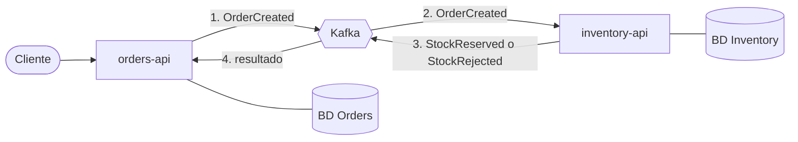
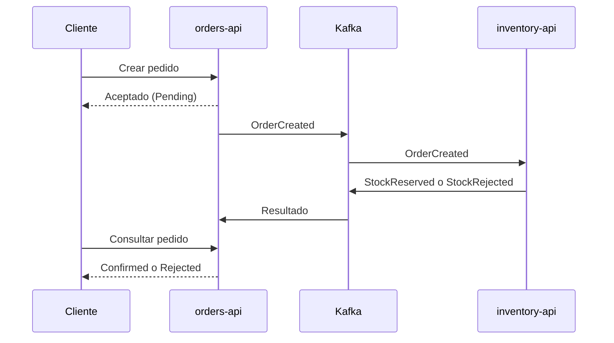

# api-services-kafka

[Read in English](README.md)

## Resumen rápido

| | |
|---|---|
| **Qué hace** | Dos servicios .NET que se comunican solo por Kafka: **orders-api** recibe pedidos e **inventory-api** reserva el stock y responde. |
| **Cómo está armado** | .NET 10 con Minimal APIs. Cada servicio tiene su propia base de datos PostgreSQL y no se llaman por HTTP. Solo comparten los tipos de mensaje (`Contracts`). |
| **Qué implementa** | Outbox transaccional · consumidores idempotentes · reintentos y topic de mensajes fallidos (dead-letter) · reserva de stock de todo o nada, segura ante pedidos simultáneos. |
| **Infraestructura** | Kafka (modo KRaft), dos PostgreSQL 16 y Kafka UI, todo con un `docker compose up`. |
| **Cómo probarlo** | Necesitas Docker. Sigue [Puesta en marcha](#puesta-en-marcha): es un comando. |

Hay también una [página de arquitectura en HTML](docs/architecture.es.html). GitHub muestra los archivos HTML como código fuente; para verla con formato, ábrela en local.

---

## Arquitectura



El mismo recorrido, paso a paso:



Mientras la respuesta de Inventory no llega, el pedido figura como `Pending`. Es la *consistencia eventual*: el sistema no pierde nada, pero los dos servicios tardan un instante en ponerse de acuerdo.

## Por qué Kafka

Si orders-api llamara a inventory-api por HTTP, un inventory caído o lento haría fallar la creación de pedidos, y cada servicio nuevo que quisiera enterarse de un pedido obligaría a modificar orders-api. Con Kafka:

- orders-api publica un hecho ("se creó este pedido") y sigue. No sabe quién lo lee.
- Si inventory-api está caído, el mensaje espera en el topic y se procesa al volver. Aun con Kafka caído, los pedidos se aceptan: los eventos esperan en el outbox.
- Un servicio nuevo puede suscribirse al topic sin tocar orders-api.

Kafka no resuelve todo. Los riesgos entre la base de datos y Kafka necesitan dos piezas más: el outbox y los consumidores idempotentes.

## Glosario de Kafka

| Término | Qué es |
|---|---|
| **Topic** | Un "buzón" con nombre donde se escriben mensajes. Kafka los conserva un tiempo, aunque ya se hayan leído. |
| **Productor / consumidor** | Quien escribe en un topic y quien lo lee. Cada servicio es las dos cosas. |
| **Partición** | Un topic se divide en particiones para repartir el trabajo. Aquí son 3 por topic. |
| **Clave (key)** | Los mensajes con la misma clave van a la misma partición y se leen en orden. Aquí la clave es el id del pedido. |
| **Offset** | La posición hasta donde un consumidor ya leyó. Si se cae, retoma desde ahí. |
| **Consumer group** | Los consumidores de un mismo servicio comparten un grupo y Kafka reparte los mensajes entre ellos. Aquí: `orders-service` e `inventory-service`. |
| **Dead-letter (DLQ)** | Un topic aparte donde se guarda el mensaje que no se pudo procesar, con la causa. Aquí: `<topic>.dlq`. |

Si vienes de Azure Service Bus: allí el mensaje se entrega y se borra. Kafka es un registro que solo crece: cada consumidor lleva su propio marcador y se pueden releer mensajes antiguos. El dead-letter, que en Service Bus viene integrado, aquí lo construimos nosotros.

## Outbox transaccional

Guardar en la base de datos y publicar en Kafka son dos acciones separadas. Si el proceso cae entre ellas, el pedido queda guardado pero el evento nunca sale, o al revés. El patrón *outbox* lo evita:

1. El pedido y el evento se guardan **en la misma transacción**; el evento va a la tabla `outbox_messages`.
2. Un `BackgroundService` lee las filas sin publicar, las envía a Kafka, espera su confirmación y las marca como publicadas. Si Kafka no responde, la fila queda pendiente y se reintenta.

Si el proceso cae justo después de que Kafka confirmó y antes de marcar la fila, el mensaje se envía otra vez. Por eso el consumidor tiene que ser idempotente.

## Consumidores idempotentes

Kafka entrega **al menos una vez**: un mismo mensaje puede llegar repetido. Cada consumidor guarda el `messageId` de lo que ya procesó en `processed_messages`, **en la misma transacción** que el cambio de datos. Si llega un repetido, lo encuentra ahí y no hace nada: el stock nunca se descuenta dos veces.

El offset se confirma solo después de que el procesamiento terminó. Si el servicio cae a medias, el mensaje se entrega de nuevo y la idempotencia evita el efecto doble.

## Fallos

| Situación | Qué pasa |
|---|---|
| Error transitorio al procesar | 3 intentos con espera creciente (500 ms, 1 s). Si todos fallan, el mensaje va al DLQ con la causa en la cabecera `error` y el consumo continúa. |
| Mensaje ilegible o sin `messageId` | Va directo al DLQ, sin reintentos. |
| Kafka no disponible | Los pedidos se aceptan igual; los eventos esperan en el outbox. |
| Dos pedidos por la última unidad | Las filas de producto se bloquean con `FOR UPDATE`: uno se reserva y el otro se rechaza. El stock nunca queda negativo. |

## Requisitos

- [.NET 10 SDK](https://dotnet.microsoft.com/download)
- Docker (para ejecutar el sistema y también los tests)

## Puesta en marcha

```bash
cd api-services-kafka
docker compose up --build
```

Levanta Kafka, las dos bases de datos, las dos APIs y Kafka UI. El servicio `kafka-init` crea los topics y termina; las APIs aplican sus migraciones al arrancar.

| Qué | Dónde |
|---|---|
| orders-api | http://localhost:8081 |
| inventory-api | http://localhost:8082 |
| Kafka UI (topics y mensajes) | http://localhost:8085 |
| Base de datos de pedidos | `localhost:5433`, base `orders`, usuario y contraseña `orders` |
| Base de datos de inventario | `localhost:5434`, base `inventory`, usuario y contraseña `inventory` |
| Kafka (desde tu máquina) | `localhost:9092` |

Las contraseñas son valores de desarrollo local. Los puertos se publican solo en `127.0.0.1`, así que otras máquinas de tu red no pueden llegar a ellos. Las dos APIs también responden `/health` y `/ready`, y Docker usa `/ready` para su health check.

### Probarlo

```bash
# Stock inicial (Laptop = 10)
curl localhost:8082/products/a1b2c3d4-0001-4000-8000-000000000001

# Crear un pedido de 2 laptops -> 202 con el orderId
curl -X POST localhost:8081/orders -H "Content-Type: application/json" \
  -d '{"items":[{"productId":"a1b2c3d4-0001-4000-8000-000000000001","quantity":2}]}'

# Consultar el pedido (cambia de Pending a Confirmed en un instante)
curl localhost:8081/orders/<orderId>

# El stock bajó a 8
curl localhost:8082/products/a1b2c3d4-0001-4000-8000-000000000001
```

Un pedido que pide más de lo que hay (por ejemplo 999 monitores) termina en `Rejected`, con el motivo en `rejectionReason`.

### Ver qué hay dentro

- **Kafka UI** (http://localhost:8085): en *Topics* se ven `orders.events` e `inventory.events` con cada mensaje, su clave, sus cabeceras y su partición. Si algo falla, aparece en los topics `.dlq`.
- **Las bases de datos**: se pueden abrir con cualquier cliente de PostgreSQL (pgAdmin, DBeaver, la extensión de PostgreSQL de VS Code) con los datos de la tabla de arriba. Interesa mirar `outbox_messages` (qué se publicó y cuándo) y `processed_messages`.

### Ejecutar una API desde el IDE

Levanta solo la infraestructura y arranca la API que quieras con otro puerto, para que no choque con el contenedor:

```bash
docker compose up -d kafka kafka-init orders-db inventory-db
dotnet run --project src/Orders.Api --urls http://localhost:5081
dotnet run --project src/Inventory.Api --urls http://localhost:5082
```

Si tenías las APIs del compose corriendo, páralas antes (`docker compose stop orders-api inventory-api`): comparten grupo de consumidores y se repartirían los mensajes.

## Endpoints

| Servicio | Método | Ruta | Respuestas |
|---|---|---|---|
| orders-api | POST | `/orders` | `202` con `{ "orderId": "..." }`; `400` si no hay líneas, hay más de 100 o una cantidad no está entre 1 y 10.000. Cabecera opcional `Idempotency-Key`: la misma clave devuelve el mismo pedido |
| orders-api | GET | `/orders/{id}` | `200` con estado, motivo y líneas; `404` |
| inventory-api | GET | `/products` | `200` |
| inventory-api | GET | `/products/{id}` | `200`; `404` |
| ambos | GET | `/health` | `200` mientras el proceso está vivo |
| ambos | GET | `/ready` | `200` si la base de datos, Kafka y el consumidor están bien; `503` si no |

No hay autenticación. Productos de ejemplo: Laptop (10), Mouse (50), Keyboard (30), Monitor (5) y Headset (20).

## Estructura

```
api-services-kafka/
  docker-compose.yml
  Directory.Packages.props     versiones de paquetes centralizadas
  src/
    Contracts/                 tipos de mensaje compartidos y nombres de topics
    Orders.Api/                dominio, datos, features, mensajería
    Inventory.Api/             dominio, datos, features, mensajería
  tests/
    Orders.Tests/  Inventory.Tests/  EndToEnd.Tests/
  docs/                        resumen de arquitectura en HTML
```

Las versiones de todos los paquetes viven en [Directory.Packages.props](Directory.Packages.props); los `csproj` solo dicen qué paquetes usan.

## Tests

```bash
dotnet test
```

Necesitas Docker: los tests levantan PostgreSQL y Kafka reales en contenedores (Testcontainers) y los borran al terminar. La primera vez descargan las imágenes, así que tardan más.

| Proyecto | Qué prueba |
|---|---|
| `Orders.Tests` (52) | Dominio del pedido, API (topes y clave de idempotencia), publicador de outbox contra Kafka real, consumidor de respuestas, reintentos y dead-letter, health checks |
| `Inventory.Tests` (39) | Reserva de stock (todo o nada, líneas repetidas, concurrencia, desbordamiento de cantidades, motivos de rechazo cortos, una reserva por pedido), API de productos, consumidor idempotente, publicador de outbox, health checks |
| `EndToEnd.Tests` (5) | Las dos APIs juntas con Kafka y PostgreSQL reales: pedido confirmado, pedido rechazado, mensaje duplicado, Kafka caído y recuperado, mensaje inválido al dead-letter |

## Decisiones de diseño

- **Outbox con publicador propio**, en lugar de publicar directo (pierde eventos) o de usar Debezium (más infraestructura y oculta la mecánica).
- **Solo `Contracts` es compartido.** El código de outbox y de consumidor está duplicado a propósito en cada servicio para que no dependan de una librería común.
- **Reserva con `FOR UPDATE`** dentro de la transacción, en lugar de un `UPDATE` condicional por fila: da todo o nada sin puntos de guardado y pone en fila a los pedidos que compiten por el mismo stock.
- **Un evento de tipo desconocido se ignora**, para poder añadir tipos nuevos a un topic sin romper a los consumidores antiguos.
- **Pruebas de extremo a extremo con las APIs en el mismo proceso**, contra Kafka y PostgreSQL reales. Así se puede parar y reiniciar Kafka. Los Dockerfiles se comprueban con `docker compose up --build`.

## Limitaciones conocidas

- Si la respuesta de Inventory acaba en el dead-letter, el pedido se queda en `Pending`: no hay reproceso automático del DLQ ni caducidad de pedidos.
- No hay flujo de cancelación: el stock reservado no se libera.
- Las filas publicadas de `outbox_messages` y las de `processed_messages` no se purgan.
- Un mensaje que nunca se puede enviar (por ejemplo, demasiado grande) bloquea a los que van detrás en el outbox.
- Sin autenticación y sin Schema Registry (los mensajes son JSON simple).

### Notas de la revisión

Estos puntos salen de una revisión que supone que los servicios corren en una red interna cerrada, no en internet.

**Corregido tras la revisión**

- Un motivo de rechazo largo ya no deja el pedido en `Pending`. Inventory lo acorta (los 3 primeros elementos y un recuento) y orders lo recorta al tamaño de la columna.
- `POST /orders` acepta como máximo 100 líneas y 10.000 unidades por línea. También admite una cabecera opcional `Idempotency-Key`: un reintento con la misma clave devuelve el mismo pedido.
- Un segundo `OrderCreated` del mismo pedido (con otro `messageId`) ya no vuelve a reservar el stock. Inventory comprueba primero el pedido, y un índice único sobre `(order_id, product_id)` es la red de seguridad.
- Un resultado que llega para un pedido que ya está decidido se registra como aviso en el log.
- El compose publica los puertos solo en `127.0.0.1`, fija la imagen de Kafka UI y tiene health checks y política de reinicio. Las dos APIs tienen `/health` (el proceso está vivo) y `/ready` (la base de datos, Kafka y el consumidor están bien).
- Las advertencias del compilador hacen fallar la compilación, y un workflow de GitHub Actions compila el código y ejecuta todos los tests.

**Todavía abierto**

*Seguridad*

- Kafka, Kafka UI y las bases de datos no tienen usuario ni cifrado (`PLAINTEXT`). Los puertos son locales, pero en una red compartida hacen falta autenticación y TLS.
- Se confía en el bus de mensajes. Quien pueda escribir en `inventory.events` y conozca un `orderId` (se devuelve en el `202`) puede confirmar o rechazar ese pedido.
- Las contraseñas de demostración están en `appsettings.json`, en el compose y dentro de la imagen de Docker. Kafka UI no tiene login.
- La cabecera `error` del topic de mensajes fallidos guarda el mensaje de la excepción, que puede incluir detalles internos.
- `AllowedHosts` es `*` y el compose no usa HTTPS.

*Rendimiento*

- La transacción del outbox sigue abierta mientras el mensaje se envía a Kafka (hasta 10 segundos). Con más de una réplica no se garantiza el orden de los mensajes, así que usa una réplica por servicio.
- Un solo hilo lee todas las particiones de un topic y los reintentos esperan dentro de ese hilo, así que un mensaje lento retrasa a los demás. Cada mensaje confirma su propio offset: es seguro, pero limita el caudal.

*Operación*

- Las migraciones se ejecutan al arrancar el proceso, sin bloqueo entre réplicas.
- Sin métricas (como el retraso del outbox) y sin trazas entre servicios.

## Lecturas de referencia

Dos artículos usados como lista de comprobación para la revisión de este proyecto:

- [Building enterprise .NET APIs](https://www.ronnydelgado.com/my-blog/building-enterprise-dotnet-apis-with-claude-skills): un catálogo de 22 patrones (capas, validación, outbox con idempotencia, health checks, auditoría, tests de integración con Testcontainers).
- [.NET development guidance](https://thecodeman.net/posts/dotnet-skills-for-coding-agents): una lista de revisión de consultas de EF Core, gestión central de paquetes, convenciones de Minimal APIs y una comprobación clara de "terminado" (compilar sin advertencias nuevas y tests en verde).

| Práctica de los artículos | Estado aquí |
|---|---|
| Outbox con idempotencia | Hecho |
| Tests de integración con `WebApplicationFactory` y Testcontainers | Hecho |
| Gestión central de paquetes | Hecho |
| Revisión de consultas de EF Core (N+1, viajes a la base, índices) | Pendiente |
| Health checks | Hecho (`/health` y `/ready`) |
| `TypedResults` en Minimal APIs | Pendiente |
| Auditoría y borrado lógico | No aplicado (no hace falta en esta demo) |
