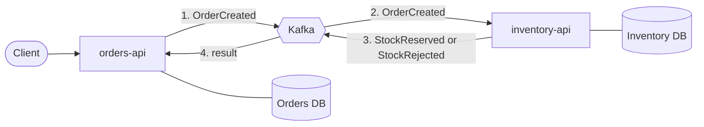
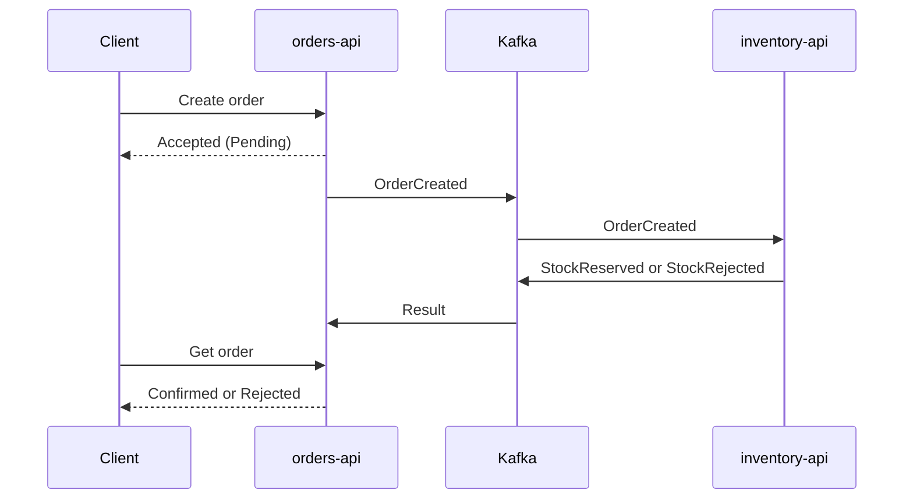

# api-services-kafka

[Leer en español](README.es.md)

## Quick summary

| | |
|---|---|
| **What it does** | Two .NET services that talk to each other only through Kafka. **orders-api** receives orders. **inventory-api** reserves the stock and answers. |
| **How it is built** | .NET 10 with Minimal APIs. Each service has its own PostgreSQL database. They never call each other over HTTP. They only share the message types (`Contracts`). |
| **What it shows** | Transactional outbox · idempotent consumers · retries and a dead-letter topic · all-or-nothing stock reservation that is safe when orders arrive at the same time. |
| **Infrastructure** | Kafka (KRaft mode), two PostgreSQL 16 databases and Kafka UI, all started with one `docker compose up`. |
| **How to try it** | You need Docker. See [Run it](#run-it): it is one command. |

There is also a short [architecture page in HTML](docs/architecture.html). GitHub shows HTML files as source code, so open it locally to see it with its layout.

---

## Architecture



The same path, step by step:



Until the answer from inventory arrives, the order is `Pending`. This is called *eventual consistency*: nothing is lost, but the two services need a short moment to agree.

## Why Kafka?

Imagine orders-api called inventory-api over HTTP. If inventory is down or slow, creating orders would fail. And every new service that wants to know about orders would force a change in orders-api. With Kafka:

- orders-api publishes a fact ("this order was created") and moves on. It does not know who reads it.
- If inventory-api is down, the message waits in the topic and is processed when the service is back. Even if Kafka is down, orders are still accepted: the events wait in the outbox.
- A new service can subscribe to the topic without any change in orders-api.

Kafka does not solve everything. The risks between the database and Kafka need two more pieces: the outbox and idempotent consumers.

## Kafka glossary

| Term | Meaning |
|---|---|
| **Topic** | A named "mailbox" where messages are written. Kafka keeps them for some time, even after they are read. |
| **Producer / consumer** | The one that writes to a topic and the one that reads from it. Each service is both. |
| **Partition** | A topic is split into partitions to share the work. Here each topic has 3. |
| **Key** | Messages with the same key go to the same partition and are read in order. Here the key is the order id. |
| **Offset** | The position up to where a consumer has read. If it stops, it continues from there. |
| **Consumer group** | The consumers of one service share a group, and Kafka shares the messages between them. Here: `orders-service` and `inventory-service`. |
| **Dead-letter queue (DLQ)** | A separate topic that keeps messages that could not be processed, with the reason. Here: `<topic>.dlq`. |

If you know Azure Service Bus: it delivers a message and then deletes it. Kafka is a log that only grows. Each consumer keeps its own bookmark, so old messages can be read again. Service Bus has a dead-letter queue built in; here we build it ourselves.

## Transactional outbox

Saving to the database and publishing to Kafka are two separate actions. If the process stops between them, the order is saved but the event is never sent, or the other way around. The *outbox* pattern solves this:

1. The order and the event are saved **in the same transaction**. The event goes to the `outbox_messages` table.
2. A `BackgroundService` reads the rows that are not published yet, sends them to Kafka, waits for Kafka to confirm, and marks them as published. If Kafka does not answer, the row stays pending and is tried again.

If the process stops right after Kafka confirmed but before the row was marked, the message is sent a second time. That is why the consumer must be idempotent.

## Idempotent consumers

Kafka delivers **at least once**: the same message can arrive twice. Each consumer stores the `messageId` of what it has processed in `processed_messages`, **in the same transaction** as the data change. If a repeated message arrives, it finds the id there and does nothing. The stock is never reduced twice.

The offset is committed only after processing is finished. If the service stops in the middle, the message is delivered again, and idempotency prevents a double effect.

## Failures

| Situation | What happens |
|---|---|
| Temporary error while processing | 3 attempts with growing waits (500 ms, 1 s). If all fail, the message goes to the DLQ with the reason in the `error` header and the consumer continues. |
| Unreadable message or no `messageId` | It goes straight to the DLQ, with no retries. |
| Kafka is down | Orders are still accepted. The events wait in the outbox. |
| Two orders for the last unit | The product rows are locked with `FOR UPDATE`: one order gets the unit, the other is rejected. Stock never goes below zero. |

## Requirements

- [.NET 10 SDK](https://dotnet.microsoft.com/download)
- Docker (to run the system and also to run the tests)

## Run it

```bash
cd api-services-kafka
docker compose up --build
```

This starts Kafka, the two databases, the two APIs and Kafka UI. The `kafka-init` service creates the topics and exits. The APIs apply their migrations when they start.

| What | Where |
|---|---|
| orders-api | http://localhost:8081 |
| inventory-api | http://localhost:8082 |
| Kafka UI (topics and messages) | http://localhost:8085 |
| Orders database | `localhost:5433`, database `orders`, user and password `orders` |
| Inventory database | `localhost:5434`, database `inventory`, user and password `inventory` |
| Kafka (from your machine) | `localhost:9092` |

The passwords are for local development only. The ports are published only on `127.0.0.1`, so other machines in your network cannot reach them. Both APIs also answer `/health` and `/ready`, and Docker uses `/ready` for its health check. Docker only marks a container as `unhealthy`: it does not restart it. Use `/health` to know whether the process is alive, and `/ready` to know whether it can do work.

### Try it

```bash
# Initial stock (Laptop = 10)
curl localhost:8082/products/a1b2c3d4-0001-4000-8000-000000000001

# Create an order for 2 laptops -> 202 with the orderId
curl -X POST localhost:8081/orders -H "Content-Type: application/json" \
  -d '{"items":[{"productId":"a1b2c3d4-0001-4000-8000-000000000001","quantity":2}]}'

# Get the order (it changes from Pending to Confirmed in a moment)
curl localhost:8081/orders/<orderId>

# The stock is now 8
curl localhost:8082/products/a1b2c3d4-0001-4000-8000-000000000001
```

An order that asks for more than the stock (for example 999 monitors) ends as `Rejected`, with the reason in `rejectionReason`.

### Look inside

- **Kafka UI** (http://localhost:8085): open *Topics* to see `orders.events` and `inventory.events` with every message, its key, its headers and its partition. If something fails, it appears in the `.dlq` topics.
- **The databases**: open them with any PostgreSQL client (pgAdmin, DBeaver, the PostgreSQL extension for VS Code) using the values in the table above. The most interesting tables are `outbox_messages` (what was published and when) and `processed_messages`.

### Run one API from your IDE

Start only the infrastructure and run the API you want on another port, so it does not clash with the container:

```bash
docker compose up -d kafka kafka-init orders-db inventory-db
dotnet run --project src/Orders.Api --urls http://localhost:5081
dotnet run --project src/Inventory.Api --urls http://localhost:5082
```

If the APIs from the compose file are running, stop them first (`docker compose stop orders-api inventory-api`). They use the same consumer group, so they would share the messages.

## Endpoints

| Service | Method | Path | Responses |
|---|---|---|---|
| orders-api | POST | `/orders` | `202` with `{ "orderId": "..." }`; `400` if there are no lines, more than 100 lines, or a quantity outside 1 to 10,000. Optional header `Idempotency-Key`: the same key returns the same order |
| orders-api | GET | `/orders/{id}` | `200` with status, reason and lines; `404` |
| inventory-api | GET | `/products` | `200` |
| inventory-api | GET | `/products/{id}` | `200`; `404` |
| both | GET | `/health` | `200` while the process is alive |
| both | GET | `/ready` | `200` when the database, Kafka and the consumer are fine; `503` if not |

There is no authentication. Sample products: Laptop (10), Mouse (50), Keyboard (30), Monitor (5) and Headset (20).

## Project structure

```
api-services-kafka/
  docker-compose.yml
  Directory.Packages.props     all package versions in one place
  src/
    Contracts/                 shared message types and topic names
    Orders.Api/                domain, data, features, messaging
    Inventory.Api/             domain, data, features, messaging
  tests/
    Orders.Tests/  Inventory.Tests/  EndToEnd.Tests/
  docs/                        architecture summary in HTML
```

The versions of all packages are in [Directory.Packages.props](Directory.Packages.props). The `csproj` files only say which packages they use.

## Tests

```bash
dotnet test
```

You need Docker. The tests start real PostgreSQL and Kafka containers (Testcontainers) and remove them at the end. The first run downloads the images, so it takes longer.

| Project | What it tests |
|---|---|
| `Orders.Tests` (53) | Order domain, API (limits and idempotency key), outbox publisher against real Kafka, result consumer, retries and dead-letter, health checks |
| `Inventory.Tests` (42) | Stock reservation (all or nothing, repeated lines, concurrency, number overflow, short rejection reasons, one final decision per order), products API, idempotent consumer, outbox publisher, health checks |
| `EndToEnd.Tests` (5) | Both APIs together with real Kafka and PostgreSQL: confirmed order, rejected order, duplicate message, Kafka down and back, invalid message to the dead-letter topic |

## Design decisions

- **Outbox with our own publisher**, instead of publishing directly (events can be lost) or using Debezium (more infrastructure, and it hides how things work).
- **Only `Contracts` is shared.** The outbox and consumer code is copied in each service on purpose, so the services do not depend on a common library.
- **Reservation with `FOR UPDATE`** inside the transaction, instead of one conditional `UPDATE` per row. It gives all-or-nothing without savepoints, and it puts orders that compete for the same stock in a line.
- **Unknown event types are ignored**, so new types can be added to a topic without breaking old consumers.
- **End-to-end tests run the APIs in the same process**, against real Kafka and PostgreSQL. This makes it possible to stop and restart Kafka. The Dockerfiles are checked with `docker compose up --build`.

## Known limitations

- If the answer from inventory ends in the dead-letter topic, the order stays `Pending`. Nothing reprocesses the DLQ and orders do not expire.
- There is no cancel flow: reserved stock is never released.
- Published rows in `outbox_messages` and rows in `processed_messages` are never deleted.
- A message that can never be sent (for example, too large) blocks the messages behind it in the outbox.
- No authentication and no Schema Registry (messages are plain JSON).

### Review notes

These points come from a review that assumes the services run on a closed internal network, not on the internet.

**Fixed after the review**

- A long rejection reason no longer leaves the order `Pending`. Inventory shortens it (the first 3 items and a count) and orders cuts it to the size of the column.
- `POST /orders` accepts at most 100 lines and 10,000 units per line. It also accepts an optional `Idempotency-Key` header: a retry with the same key returns the same order.
- A second `OrderCreated` for the same order (with another `messageId`) no longer reserves the stock again. Inventory checks the order first, and a unique index on `(order_id, product_id)` is the safety net.
- A result that arrives for an order that is already decided is logged as a warning.
- Inventory remembers its decision for every order, whether it was yes or no. A later message for the same order gets the same answer and takes no stock. Before, a second message for an order that had been rejected could still reserve stock, and the order (already `Rejected`) would ignore it.
- The consumer reports that it is alive at every attempt, not only once per loop, and `/ready` allows 60 seconds of silence (above the 30 seconds that a database command can wait). A slow or retried message no longer makes `/ready` fail.
- The compose file publishes the ports only on `127.0.0.1`, pins the Kafka UI image, and has health checks and a restart policy. Both APIs have `/health` (the process is alive) and `/ready` (the database, Kafka and the consumer are fine).
- Compiler warnings fail the build.

**Still open**

*Security*

- Kafka, Kafka UI and the databases have no login and no encryption (`PLAINTEXT`). The ports are local, but on a shared network you need authentication and TLS.
- The message bus is trusted. Anyone who can write to `inventory.events` and knows an `orderId` (it is returned in the `202`) can confirm or reject that order.
- The demo passwords are in `appsettings.json`, in the compose file and inside the Docker image. Kafka UI has no login.
- The `error` header in the dead-letter topic holds the exception message, which can include internal details.
- `AllowedHosts` is `*` and the compose file has no HTTPS.

*Reliability*

- Using the same `Idempotency-Key` with a different body returns the first order (`202`), not a `409`. Someone who reuses a key by mistake believes the new order was created.

*Performance*

- The outbox transaction stays open while the message is sent to Kafka (up to 10 seconds). With more than one replica, the order of the messages is not guaranteed, so run one replica per service.
- One thread reads all the partitions of a topic, and the retries wait inside that thread, so a slow message delays the others. Each message commits its own offset. This is safe, but it limits the throughput.

*Operations*

- Migrations run when the process starts, with no lock between replicas.
- No metrics (such as outbox lag) and no tracing across services.

## Further reading

Two articles used as a checklist for the review of this project:

- [Building enterprise .NET APIs](https://www.ronnydelgado.com/my-blog/building-enterprise-dotnet-apis-with-claude-skills): a catalog of 22 patterns (layers, validation, outbox with idempotency, health checks, audit trail, integration tests with Testcontainers).
- [.NET development guidance](https://thecodeman.net/posts/dotnet-skills-for-coding-agents): a review checklist for EF Core queries, central package management, Minimal API conventions and a clear "done" check (build without new warnings and passing tests).

| Practice from the articles | Status here |
|---|---|
| Outbox with idempotency | Done |
| Integration tests with `WebApplicationFactory` and Testcontainers | Done |
| Central package management | Done |
| Review of EF Core queries (N+1, round-trips, indexes) | Pending |
| Health checks | Done (`/health` and `/ready`) |
| `TypedResults` in Minimal APIs | Pending |
| Audit trail and soft delete | Not applied (not needed for this demo) |
