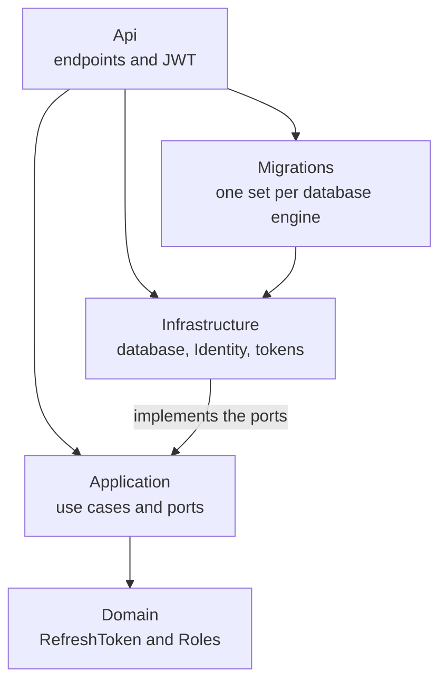
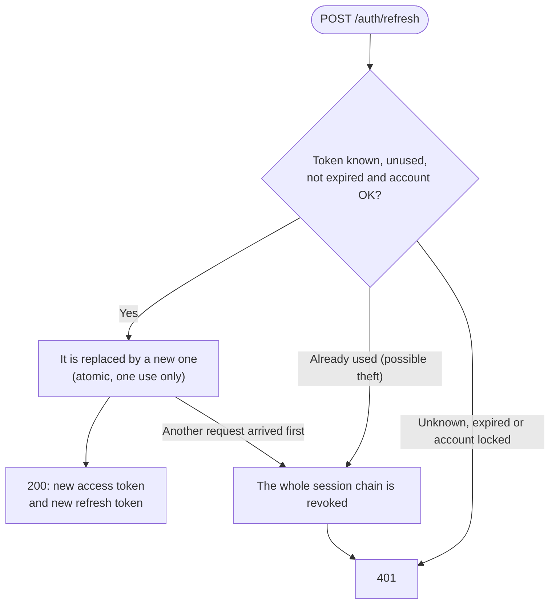

# api-users

[Leer en español](README.es.md)

## Quick summary

| | |
|---|---|
| **What it does** | Registers users, lets them sign in and returns JWT tokens. It also renews and closes sessions, and it has an admin endpoint. |
| **How it is built** | .NET 10 with Minimal APIs and Clean Architecture in 4 projects: `Domain`, `Application`, `Infrastructure` and `Api`. |
| **What it shows** | Login with JWT (15 min) and a one-use refresh token (7 days) with theft detection · roles `User` and `Admin` · account lockout after 5 failed attempts · paginated user list · rate limit on `/auth` · OpenAPI/Scalar documentation · 129 tests (integration, unit and architecture). |
| **Database** | **SQL Server** or **PostgreSQL** (Supabase included), chosen with `Database:Provider`. |
| **How to try it** | You need .NET 10 and Docker. Follow [Run it with SQL Server](#run-it-with-sql-server): it takes four steps. |

The full detail is below.

---

A REST API in .NET 10 to register users and authenticate them with JWT. It includes one-use refresh tokens with reuse detection, roles (`User` and `Admin`) and storage in **SQL Server** or **PostgreSQL**, chosen by configuration (Supabase is included, because it is PostgreSQL).

## Features

- Register, login, session renewal (`refresh`) and session close (`logout`).
- JWT access token of 15 minutes and refresh token of 7 days.
- Refresh tokens are stored **only as a SHA-256 hash**. Each one can be used only once: when it is renewed, the old one becomes invalid. If someone sends a token that was already used, the whole session chain is revoked (a sign of theft). The rotation is atomic, so two requests at the same time with the same token cannot both succeed.
- Passwords with ASP.NET Core Identity, account lockout after 5 failed attempts (5 minutes) and one single `401` answer for an unknown email, a wrong password or a locked account.
- Role-based authorization. The first admin is created from the configuration, never from the code.
- Interactive documentation with OpenAPI and Scalar (development only).
- Integration tests against a real database in a container, which can run with both database engines.

## Architecture

Clean Architecture in four projects, with the dependencies pointing inwards:



| Project | Responsibility |
|---|---|
| `ApiUsers.Domain` | The `RefreshToken` entity with its rules (`IsActive`, `Revoke`) and `Roles`. No dependencies. |
| `ApiUsers.Application` | Use cases (`AuthService`, `UserService`), DTOs and the ports (`IIdentityService`, `ITokenGenerator`, `IRefreshTokenRepository`). |
| `ApiUsers.Infrastructure` | EF Core, ASP.NET Core Identity, JWT generation, the token repository and seeding. It implements the ports. |
| `ApiUsers.Migrations.SqlServer` / `.PostgreSql` | EF Core migrations, one set per database engine because the SQL is different. |
| `ApiUsers.Api` | Endpoints (Minimal APIs), JWT authentication and OpenAPI. It only translates HTTP. |

`Application` does not know `UserManager` or EF Core, and `Infrastructure` does not know `Api` or the migration projects. Architecture tests check this.

### Refresh flow

This is the most delicate part of the design: each refresh token is used only once, and using a token that was already used is treated as theft.



There is also a [full architecture summary in HTML](docs/architecture.html) (in Spanish) with the endpoints, the data model and the start-up order. GitHub shows HTML files as source code, so open it locally to see it with its layout.

## Requirements

- [.NET 10 SDK](https://dotnet.microsoft.com/download)
- [Docker](https://www.docker.com/) (for the database and for the tests)

## Run it with SQL Server

From the `api-users` folder:

```bash
# 1. Docker passwords (the .env file is not versioned)
cp .env.example .env          # on Windows: copy .env.example .env
# edit .env and fill in MSSQL_SA_PASSWORD and POSTGRES_PASSWORD

# 2. Database
docker compose up -d

# 3. API secrets (they are stored outside the repository)
cd src/ApiUsers.Api
dotnet user-secrets set "ConnectionStrings:Default" "Server=localhost,1433;Database=ApiUsers;User Id=sa;Password=<MSSQL_SA_PASSWORD>;TrustServerCertificate=True"
dotnet user-secrets set "Jwt:SigningKey" "<random key of at least 32 characters>"
dotnet user-secrets set "Admin:Email" "admin@example.com"
dotnet user-secrets set "Admin:Password" "<strong password>"

# 4. Run
dotnet run
```

In development, the API applies the migrations and creates the roles and the admin when it starts. It also opens the documentation at `http://localhost:5299/scalar/v1`.

To generate a signing key: `openssl rand -base64 48`.

## Use PostgreSQL or Supabase

The database is chosen with `Database:Provider` (`SqlServer` by default, or `PostgreSql`). An unknown value stops the API from starting.

**Local PostgreSQL**

```bash
docker compose --profile postgres up -d postgres
cd src/ApiUsers.Api
dotnet user-secrets set "Database:Provider" "PostgreSql"
dotnet user-secrets set "ConnectionStrings:Default" "Host=localhost;Port=5432;Database=apiusers;Username=postgres;Password=<POSTGRES_PASSWORD>"
```

**Supabase** (hosted PostgreSQL): use the connection string of your project, with SSL required:

```bash
dotnet user-secrets set "Database:Provider" "PostgreSql"
dotnet user-secrets set "ConnectionStrings:Default" "Host=<Supabase host>;Port=5432;Database=postgres;Username=<user>;Password=<password>;SSL Mode=Require;Trust Server Certificate=true"
```

The host and the user depend on whether you use the direct connection or the pooler. Copy them from the Supabase dashboard.

## Configuration

| Key | Description | Default |
|---|---|---|
| `Database:Provider` | `SqlServer` or `PostgreSql` | `SqlServer` |
| `Database:MigrateOnStartup` | Applies migrations and creates roles and admin at start | `false` (`true` in Development) |
| `ConnectionStrings:Default` | Connection string | — (required) |
| `Jwt:SigningKey` | HS256 key, at least 32 bytes | — (required) |
| `Jwt:Issuer` / `Jwt:Audience` | Issuer and audience of the tokens | `api-users` / `api-users-clients` |
| `Jwt:AccessTokenMinutes` | Life of the access token | `15` |
| `Jwt:RefreshTokenDays` | Life of the refresh token | `7` |
| `Admin:Email` / `Admin:Password` | First admin (ignored if one of them is missing) | — |
| `RateLimiting:AuthPermitLimit` | Requests allowed to `/auth/*` per IP in each window | `20` |
| `RateLimiting:AuthWindowSeconds` | Length of the sliding window, in seconds | `60` |
| `ForwardedHeaders:Enabled` | Trust `X-Forwarded-For` and `X-Forwarded-Proto` from the listed proxies | `false` |
| `ForwardedHeaders:KnownProxies` | IPs of the trusted reverse proxies (list) | — |
| `ForwardedHeaders:KnownNetworks` | CIDR networks of trusted proxies, for example `10.0.0.0/8` (list) | — |

The API checks `Jwt` and `Database:Provider` when it starts, and it fails with a clear message if something is wrong. The required keys are never saved in the repository: use `dotnet user-secrets` in development and environment variables (`Jwt__SigningKey`, ...) in other environments.

With `Database:MigrateOnStartup` set to `false`, the API does not touch the schema: apply the migrations and create the roles yourself before you use it.

### Security and deployment

- **Passwords:** at least 10 characters, with an uppercase letter, a lowercase letter, a digit and a symbol.
- **Rate limit:** `/auth/*` answers `429` with `Retry-After` when the limit per IP is passed. The sliding window does not let two full bursts through at the edge of the window.
- **HTTPS:** outside Development, the API turns on HSTS and redirects HTTP to HTTPS.
- **Behind a reverse proxy that ends TLS:** turn on `ForwardedHeaders:Enabled` and say in `KnownProxies` or `KnownNetworks` which proxies are trusted. Then the API sees the real client IP (for the rate limit) and the original scheme (to avoid a redirect loop). It is off by default on purpose: if the API accepted these headers from any client, someone could fake `X-Forwarded-For` to skip the limit. If you turn it on without any proxy, the API does not start.

```bash
dotnet user-secrets set "ForwardedHeaders:Enabled" "true"
dotnet user-secrets set "ForwardedHeaders:KnownProxies:0" "10.0.0.5"
```
- **Allowed hosts:** `AllowedHosts` is `*` by default. In production, limit it to your domain.
- **Roles and sessions:** the refresh rejects locked accounts, and `GET /users` checks in the database that the caller is still an `Admin`, without waiting for the access token to expire.

## Endpoints

| Method | Path | Access | Description |
|---|---|---|---|
| POST | `/auth/register` | public | Creates a user with the `User` role |
| POST | `/auth/login` | public | Returns an access token and a refresh token |
| POST | `/auth/refresh` | public (with a refresh token) | Rotates the refresh token and issues a new pair |
| POST | `/auth/logout` | authenticated | Revokes the session of the given refresh token |
| GET | `/users/me` | authenticated | Data of the current user |
| GET | `/users?page=1&pageSize=20` | `Admin` role | Paginated list of users (maximum 100 per page) |
| GET | `/health` | public | Liveness check |

Example:

```bash
curl -X POST http://localhost:5299/auth/register -H "Content-Type: application/json" \
  -d '{"email":"ana@example.com","password":"Passw0rd!x"}'

curl -X POST http://localhost:5299/auth/login -H "Content-Type: application/json" \
  -d '{"email":"ana@example.com","password":"Passw0rd!x"}'
# -> { "accessToken": "...", "refreshToken": "...", ... }

curl http://localhost:5299/users/me -H "Authorization: Bearer <accessToken>"

curl -X POST http://localhost:5299/auth/refresh -H "Content-Type: application/json" \
  -d '{"refreshToken":"<refreshToken>"}'
```

Errors use the standard `ProblemDetails` format.

## Tests

The tests are integration tests. They start the real API against a temporary database in a container, so they need Docker.

```bash
dotnet test                                   # SQL Server
TEST_DB_PROVIDER=PostgreSql dotnet test       # PostgreSQL (in PowerShell: $env:TEST_DB_PROVIDER="PostgreSql")
```

## Migrations

Each database engine has its own migrations project. To add a migration, from `api-users`:

```bash
dotnet tool restore

# SQL Server
Database__Provider=SqlServer ConnectionStrings__Default="Server=localhost;Database=x;User Id=sa;Password=x;TrustServerCertificate=True" \
  dotnet ef migrations add <Name> -p src/ApiUsers.Migrations.SqlServer -s src/ApiUsers.Api -o Migrations

# PostgreSQL
Database__Provider=PostgreSql ConnectionStrings__Default="Host=localhost;Database=x;Username=x;Password=x" \
  dotnet ef migrations add <Name> -p src/ApiUsers.Migrations.PostgreSql -s src/ApiUsers.Api -o Migrations
```

## Checks performed

This is what was run on the code (November 2026). It shows how far the verification goes.

| Check | How it was done | What it covers |
|---|---|---|
| **Integration tests** | The real API with `WebApplicationFactory` and a database in a container, with SQL Server and with PostgreSQL | All endpoints, input validation, authentication and authorization, account lockout, seeding, OpenAPI and start-up with an invalid configuration |
| **Unit tests** | Domain rules and `AuthService` use cases with a fake repository and a fake identity service, without a database | Every branch of refresh and logout, including the ones that a real race cannot force |
| **Architecture tests** | A check of the references between assemblies | `Domain` depends on nothing, `Application` depends only on `Domain`, and `Infrastructure` does not know `Api` or the migrations |
| **Test-driven development** | Each new behavior started with a test that was seen failing for the expected reason | The tests really detect the behavior they say they test |
| **Concurrency** | Requests at the same time with the same refresh token and with the same email, repeated several times on both engines | The atomic token rotation and the duplicate registration at the same time (which gave a 500 and was fixed) |
| **Manual mutation review** | Small code changes that no test would have noticed were listed (removing a filter, changing `<` to `<=`...) and a test was added for each one | The quality of the test suite itself, not only of the code |
| **Security review** | Static review of authentication, JWT, sessions, exposure and configuration, before each commit and in later rounds | Token forgery (`alg: none`, another key, changed payload), refresh token theft, user enumeration, response times, escalation to `Admin`, brute force |
| **Code and performance review** | Static review before each commit | Indexes, no N+1 queries, limited pagination, separation by layers |
| **Independent reviews** | Several outside rounds on the code and the tests | The findings were applied or written down in the limitations below |
| **Dependencies** | `dotnet list package --vulnerable --include-transitive` | No packages with known vulnerabilities at the time of the check |
| **Strict build** | `dotnet build -warnaserror` | Zero warnings |
| **Manual end-to-end check** | A full run with `curl` against SQL Server in Docker | Register, login, refresh, reuse of a token, logout, admin role and documentation |

To repeat the automatic checks, from `api-users`:

```bash
dotnet test
TEST_DB_PROVIDER=PostgreSql dotnet test
dotnet build -warnaserror
dotnet list package --vulnerable --include-transitive
```

**What was not done:** penetration tests, load tests with performance measurements, code coverage measurement, analysis with an automated security scanner (static or dynamic) and a review of the infrastructure where it is deployed. The security and performance reviews were static.

## Known limitations

Things this API does not do, and that you should solve before you expose it to real users:

- **No email confirmation.** Anyone can register someone else's email. You need an email-sending service and you need to require `EmailConfirmed` at login.
- **The `409` on register shows that an email already exists.** This comes with answering with a conflict. Login always returns the same `401`.
- **The rate limit lives in memory and is per instance.** With several replicas, each one counts on its own. A global limit needs a shared store, such as Redis.
- **Seeding is not atomic.** `DbSeeder` checks and then creates: two instances that start at the same time with `MigrateOnStartup` can compete, and one can fail with a duplicate. Starting a single instance to seed avoids this.
- **`TokenHash` uses `nvarchar(64)`,** and its comparison depends on the collation (case-insensitive in SQL Server, case-sensitive in PostgreSQL). There is no practical risk because the token has 256 random bits. A `varchar(44)` with a binary collation would be more exact.
- **`TryRotateAsync` uses a manual transaction.** If `EnableRetryOnFailure` is ever turned on, wrap it in `CreateExecutionStrategy().ExecuteAsync(...)`.
- **Expired or revoked refresh tokens are not deleted,** so the table grows. A periodic cleanup task solves this. The cleanup must filter by `ExpiresAtUtc` and not by `RevokedAtUtc`: the reuse detection needs to keep the revoked rows until their original expiry. An index on `ExpiresAtUtc` is only needed if the delete is slow.
- **A single signing key.** Rotating it invalidates the current access tokens. To rotate it without downtime, you would need a `kid` and a period with two keys.
- **Role changes or the deletion of an account take up to 15 minutes** to show in the endpoints that only read the token. `GET /users`, `GET /users/me` and refresh do query the database.

## Design decisions

- **Identity behind a port.** Identity handles passwords, lockout and roles, but it stays isolated in `Infrastructure`. The use cases do not depend on it.
- **Refresh tokens with families.** Each session shares a family identifier. Using a token that was already used, or losing a rotation race, revokes the whole family.
- **An access token cannot be revoked before it expires** (15 minutes). This is a normal property of JWT. `logout` revokes the refresh token, and `/users/me` queries the database to reject deleted accounts.
- **Answers that do not reveal information.** Login gives the same answer for an unknown email, a wrong password or a locked account, and it computes a hash even if the email does not exist, so the response times are the same.
- **Paginated lists** with a maximum, so an admin endpoint does not return a whole table.
- **One set of migrations per engine**, in separate projects, so the SQL of each provider is not mixed.
